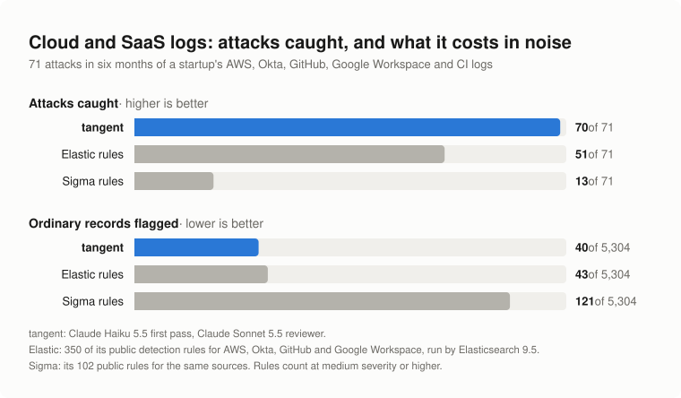
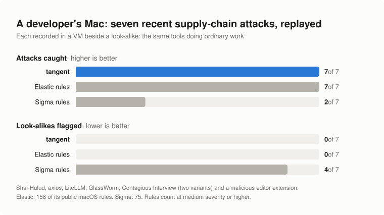

<p align="center">
  
</p>
<h1 align="center">Tangent</h1>
<p align="center"><em>Have an LLM watch your logs.</em></p>


<p align="center">
  <a href="https://github.com/EthanBlackburn/tangent/actions">
  </a>
  <a href="https://twitter.com/telophasehq">
  
  </a>

</p>

<p align="center">
  <a href="https://docs.telophasehq.com">Documentation</a>
  <span>&nbsp;&nbsp;•&nbsp;&nbsp;</span>
  <a href="https://discord.gg/ZUHB3BRa8c">Discord</a>
  <span>&nbsp;&nbsp;•&nbsp;&nbsp;</span>
  <a href="https://github.com/EthanBlackburn/tangent/issues/new">Issues</a>
</p>

Shai-Hulud. The axios and LiteLLM compromises. The fake recruiter's take-home
project. The poisoned editor extensions. Each one landed on developers'
machines, and at most companies nothing was watching when it did: no SIEM,
no detection rules, no one whose job it is to read the logs.

Tangent pulls logs from your Macs and your cloud (AWS, GitHub, Okta, Google
Workspace), feeds them to a model, and lets you know when something is
wrong.

## What it catches

We re-created each of these attacks, ran it for real on a developer's Mac
(a VM) with tangent watching, and beside each one recorded a developer doing
the same kinds of things for honest reasons. Each recording went through
tangent three times.

| Attack | What it does on the Mac | Caught | Look-alike left alone |
|---|---|---|---|
| Shai-Hulud | An npm install script hunts the Mac for tokens and keys, and republishes the developer's own packages with itself added | 3 of 3 | 3 of 3 |
| axios compromise | An npm install script drops a remote-access tool made to look like an Apple daemon and leaves it running | 3 of 3 | 3 of 3 |
| LiteLLM compromise | A file the PyPI package installs runs on every Python start and sweeps credentials | 3 of 3 | 3 of 3 |
| Contagious Interview | Running a fake recruiter's take-home project reads wallet, browser and keychain files, uploads them, and leaves a backdoor running | 3 of 3 | 3 of 3 |
| Contagious Interview, by the editor | Opening the same project's folder in the editor is enough: a hidden task pipes a script into bash | 3 of 3 | 3 of 3 |
| GlassWorm | An editor extension copies the login keychain, wallets and credentials, uploads them and installs a login item | 3 of 3 | 3 of 3 |
| Trojanised Claude Code extension | An editor extension adds an SSH key, opens a reverse tunnel and installs a login item | 3 of 3 | 3 of 3 |

Every case, what is real in its recording and what is stood in, and how to
run it yourself: [tangent-eval/macos](https://github.com/EthanBlackburn/tangent-eval/tree/main/macos).

## What it costs

For a company of 50, with Claude Haiku 5.5 reading, billed to your own model
account:

| | a day |
|---|---|
| AWS (CloudTrail) | $2–20 |
| Okta | $0.60 |
| Google Workspace | $0.35–0.70 |
| GitHub | $0.30 |

About a cent a day for each person in each source that sees them. With a
model on your own machine, nothing. These are our estimates;
[the working](#the-cost-worked-out) is below.

## What you get

Not a rule name and a severity. This is tangent's alert on a re-creation of
the trojanised Claude Code extension that Cursor's marketplace carried in
October 2026, run on a Mac with tangent watching (shortened):

> VS Code's Code Helper (Plugin) process, acting on behalf of the extension
> acme-tools.acme-assist-2.1.3, ran a hidden script `~/.config/.mtr` […]
> Before launching it, the same helper contacted ifconfig.me and
> api.ipify.org to learn the host's public IP, created
> `~/.ssh/authorized_keys` and a LaunchAgent masquerading as
> `~/Library/LaunchAgents/com.apple.sysstatd.plist`, and ran
> `/usr/sbin/systemsetup -setremotelogin on` […] The `.mtr` script then
> repeatedly (every 60s […]) launched `ssh -N -R *:0:localhost:22 […]`,
> opening a persistent reverse SSH tunnel from the Mac to an external host
> using a hidden private key. This was not requested by the owner […] and
> was triggered purely by the extension loading.
>
> **What to do:** Immediately disable remote login, remove/inspect
> `~/.ssh/authorized_keys` for the injected key, remove the LaunchAgent
> […], kill any running reverse-tunnel ssh processes […], and
> delete/quarantine the acme-tools.acme-assist VS Code extension […]

And this is what it said of a developer on the same Mac adding their own SSH
key, checking it against GitHub and installing a database that starts at
login:

> That key is this Mac's own public key, so it grants login only to someone
> who already holds the owner's private key. […] Homebrew installed redis
> and created its sh.brew.redis LaunchAgent, which is Homebrew's normal
> service setup. `ssh -T git@github.com` checked GitHub access.

No alert. Both wrote `authorized_keys`, ran `ssh` and made a launch item. A
rule on any one of those fires on both or on neither. Rule sets that tell
them apart exist (Elastic's did, below) and are the work of a detection
team; nobody at a company of 50 writes or keeps them. A model can tell them
apart with no rules at all.

## Against detection rules

The usual way to watch logs is a SIEM and its detection rules. We ran the
two public rule sets, Elastic's and Sigma's, over the same logs as tangent.

<picture>
  <source media="(prefers-color-scheme: dark)" srcset="docs/img/cloud-dark.svg">
  
</picture>

Six months of a made-up startup's AWS, Okta, GitHub, Google Workspace and CI
logs, with 71 attacks placed in them: 35 AWS techniques from Stratus Red
Team, and 36 cases we wrote. Tangent caught 70, Elastic's rules 51 and
Sigma's 13, and tangent flagged about as few ordinary records as Elastic's
rules did.

The gap is in the cases we wrote: tangent caught 36 of 36 and Elastic's
rules 16. Eight of them are in CI job logs and runner egress, which no
public rule reads. On the Stratus techniques Elastic's rules caught 35 of 35
and tangent 34.

<picture>
  <source media="(prefers-color-scheme: dark)" srcset="docs/img/mac-dark.svg">
  
</picture>

On the seven Mac attacks above, Elastic's rules did as well as tangent: all
seven caught and no look-alike flagged. Sigma's caught two and flagged four
of the look-alikes.

So good rules get there on the Mac, and most of the way in the cloud.
Elastic's are written and kept by a detection team and run in Elastic's
stack, with its agent on every machine. Tangent gets there with a model and
no rules.

How it was measured:

- A rule counts at medium severity or higher.
- Elastic's cloud rules were run by Elasticsearch 9.5 itself: 350 of them,
  leaving out the machine-learning rules and those that read logs the corpus
  does not have. Its Mac rules were run by Elastic's `eql` package, with 13
  rules in other languages translated by hand; one of those is the only rule
  that caught GlassWorm.
- The mapping from each provider's records to the fields Elastic's rules
  read is ours, not Elastic's ingest pipelines.
- Tangent in the cloud is Claude Haiku 5.5 reading first and Claude Sonnet
  5.5 investigating each alert. That second step is not in a release yet for
  the cloud. Haiku alone caught the same 70 and flagged 462 of the 5,304
  ordinary records.
- The startup, its logs and the 36 cases are ours, and the look-alikes on
  the Mac were built to test tangent, not rules.

## What it has not shown

How often it cries wolf on a real working day. The look-alikes above were
left alone, but false alarms over real days are a separate measurement, and
it is not done. The cloud numbers above are from logs we made, and the run
behind them, with the rule comparison, is not yet in
[tangent-eval](https://github.com/EthanBlackburn/tangent-eval) for you to
repeat.

## Try it on your own AWS account

Your account's last day of CloudTrail, read by Claude Haiku 5.5 on Bedrock.
Three commands and an AWS profile; nothing to deploy.

```bash
curl --proto '=https' --tlsv1.2 -LsSf https://github.com/EthanBlackburn/tangent/releases/latest/download/tangent-cli-installer.sh | sh
tangent init                                     # writes tangent.yaml
tangent replay --config tangent.yaml --from 1d   # says how many records there are before it judges any
```

What it flagged is in `alerts.ndjson`. [docs/try-it.md](/docs/try-it.md) has
the permissions it needs and what the first run fetches.

`tangent init` and the packs are newer than 0.1.9, the latest release, which
the installer fetches: until the next release, these three lines stop at
`init`.

On a Mac: [examples/macos](/examples/macos) starts the sensor, the model and
a second look at each alert together, and asks you about what is left in a
dialog.

## What it watches

| | reads | grows with |
|---|---|---|
| [AWS](/packs/cloudtrail) | CloudTrail, every account of an organization trail | services, scheduled jobs and deploys, more than people |
| [GitHub](/packs/github) | the org audit log, Actions job logs, runner egress | engineers |
| [Okta](/packs/okta) | the System Log | people |
| [Google Workspace](/packs/google_workspace) | login, token, Drive and admin activity | people |
| [Supabase](/packs/supabase) | a project's Auth logs | your product's users |
| [a developer's Mac](/packs/macos) | every program run, and reads and writes of credentials, AI-agent settings and what starts at login | what the developer and their coding agents do |

Anything else comes in as JSON lines over a socket and wants a
[pack](/docs/reference.md#writing-a-pack) of its own: a small plugin that
says who did what, from where, to what.

## How it works

1. **It reads the log where it already is.** Tangent's sources read the
   providers' own audit logs with a read-only credential. No agents on
   servers.
2. **It makes each record plain.** A pack turns a provider's record into who
   did what, from where, to what, and adds what a reader would look up: the
   address's country and owner, whether it is a hosting provider, Tor or
   your office, whether the actor is one of your people.
3. **It gives the model the history.** Before the model sees someone's
   records it is told who they are, how long they have been seen, and what
   they are doing for the first time: an API, a country, a client, an OAuth
   app. Facts, kept on your machine, not a score.
4. **The model decides.** There are no rules to write and none to tune. You
   tell it about your company in a few lines of YAML (who works there, which
   countries, what your office's addresses are) and the rest it reads.
5. **You hear about what is left.** On the Mac, a second model investigates
   each alert with the machine's history to query before you see it, and
   clears what turns out to be the owner's own work.

It runs as one process, on a laptop or a small server. Your logs stay on
that machine, as Parquet files you can query with SQL. What the model is
shown goes to the model you chose: Amazon Bedrock in your own account, any
OpenAI-compatible endpoint, or a model on the same machine, in which case
nothing leaves it.

## The cost, worked out

What the model charges, and nothing else. Rough ranges for a company of 50
people, each active about eight hours a day, with Claude Haiku 5.5 reading
($0.10 a million tokens in, $0.50 out):

| | grows with | a day | Haiku 5.5, a day |
|---|---|---|---|
| [AWS](/packs/cloudtrail) | services, scheduled jobs and deploys, more than people | 50k–500k events | $2–20 |
| [Google Workspace](/packs/google_workspace) | people: 100–500 events each, most of them Drive | 5k–25k events | $0.35–0.70 |
| [Okta](/packs/okta) | people: 20–100 events each | 1k–5k events | $0.60 |
| [GitHub](/packs/github) | engineers: 20–200 events each | 1k–10k events | $0.30 |

A person costs about a cent a day or less in each source that sees them.
The Mac is not priced yet. For your own volume:

```
$15 for each million logs  +  $12 for each GB of them
```

| logs a day | 250 B each | 500 B | 1 KB | 2 KB |
|---|---|---|---|---|
| 100k | $1.80 | $2.10 | $2.70 | $3.90 |
| 1M | $18 | $21 | $27 | $39 |
| 10M | $180 | $210 | $270 | $390 |

A month is thirty times as much. The count matters more than the size. A log
reaches the model as a trimmed line, about a token for every 9 bytes it had,
but each one also carries who did it and what is known of them, a share of
the prompt and of the actor's history, and gets an answer (about 11 tokens to
pass, 150 to flag): below 1 KB, that is most of what a log costs. The rule
fits real CloudTrail, GitHub and Google Workspace logs, and overstates
Okta's, which trim further.

Two things the count must include:

- People. A request is one actor's logs: up to thirty new ones, and its
  latest ten already judged again, which the model answers too. A busy
  actor, a service role or an app server, fills one with new logs. A quiet
  one, a person, goes an hour after its first new log. Count a person as
  their logs plus ten for each hour they are active.
- Throughput. At 2–10 s a Haiku 5.5 request, four requests at once keep up
  with 35k–170k requests a day, 1.4M–6.8M logs; raise
  `inference.judge.concurrency` past that.

Where it stops being cheap: a trail that also logs data events (S3 objects,
Lambda invocations) can have ten to a hundred times CloudTrail's events, and
VPC Flow Logs, 5M–30M records a day at a startup, would be $80–500 a day.
There is no pack for flow logs: one would roll them up before the model.

Storage is small: every log is kept once, about 20 bytes each on a day of
CloudTrail, and deleting old hours trims it.

These are estimates. Log sizes are measured on samples (CloudTrail on 20k
events, the others on tens to hundreds), tokens with Claude Haiku 4.5's
count scaled to 5.5's, the prices are Anthropic's own (Bedrock sets its
own), and the volumes are typical of startups, not yours: `tangent replay`
on a day of your own logs says what yours are.

## What it is not

- **Not a SIEM.** No dashboards, no search UI, no case management. It keeps
  your logs as Parquet and writes alerts to a file; where they go from there
  is yours.
- **Not the same answer every time.** A model reads the logs, and models
  vary: that is why every result above is a count over three runs.
- **Not a wall.** It tells you. It does not block anything.

## Under it, a stream processor

Tangent is a log pipeline first: sources, sinks, and plugins that are real
code (Rust, Go, Python) compiled to WASM and run in a sandbox, at up to
480 MB/s end to end ([benchmarks](/docs/reference.md#benchmarks)). The packs
are plugins, and the model is one more node. So anything here can be
changed, replaced or extended in a language you already write:
[docs/reference.md](/docs/reference.md) is the manual, and
[packs](/packs/README.md) says what a pack is.

## Install
```bash
# Homebrew
brew tap telophasehq/telophase
brew install tangent-cli
tangent --version

# with install script
curl --proto '=https' --tlsv1.2 -LsSf https://github.com/EthanBlackburn/tangent/releases/latest/download/tangent-cli-installer.sh | sh
tangent --version

# cargo
cargo install --git https://github.com/EthanBlackburn/tangent tangent-cli

# docker
docker pull ghcr.io/telophasehq/tangent-toolchain
docker run --rm --init ghcr.io/telophasehq/tangent-toolchain <command>

```


## License

Apache-2.0. See `LICENSE`.
